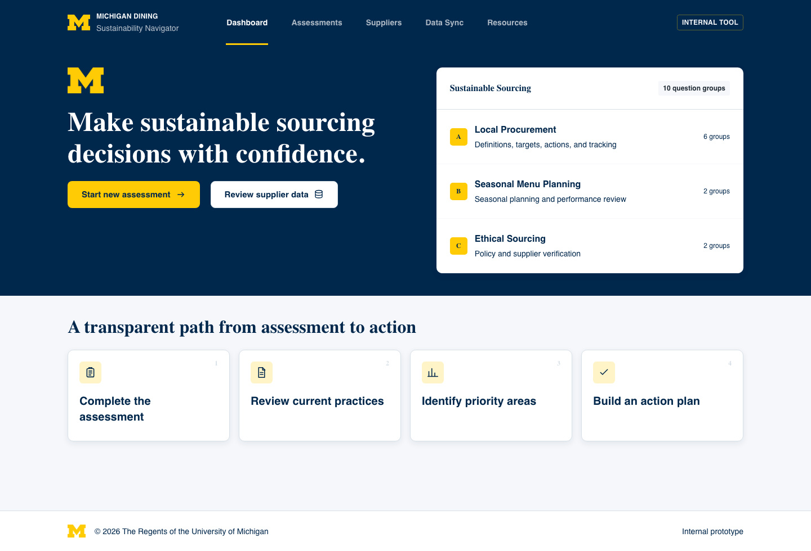
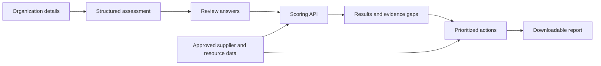

# Michigan Dining Sustainability Navigator

> A public portfolio case study of a private University of Michigan AI Clinic project. Client data, internal source files, private repository history, and deployment credentials are intentionally excluded.

## Overview

The Michigan Dining Sustainability Navigator is a five-week prototype that turns a structured sustainable-sourcing assessment into transparent scores, prioritized actions, supplier-data review prompts, recommended resources, and a downloadable report.

The project was developed for Michigan Dining through the University of Michigan AI Clinic. The working product remains in a private organization repository; this public repository documents the product, architecture, and my contribution without exposing client information.

## What the prototype does

- Guides users through a structured sustainable-sourcing assessment.
- Calculates weighted maturity scores with answer-coverage and evidence-confidence disclosures.
- Identifies information gaps and produces up to three prioritized actions.
- Connects recommendations to approved sustainability frameworks and source citations.
- Reviews sanitized supplier records without presenting them as endorsements.
- Synchronizes approved supplier and resource updates from a structured spreadsheet.
- Generates a readable PDF action plan with clickable references.

## My role

I coordinated the project across product planning, data preparation, stakeholder communication, UX review, and technical integration. My work included:

- Translating client materials and stakeholder feedback into a realistic MVP scope.
- Cleaning and structuring supplier, evidence, questionnaire, and scoring data.
- Coordinating frontend, backend, and UX work across the project team.
- Designing the supplier and resource update workflow.
- Reviewing scoring transparency, recommendations, citations, and report usability.
- Managing the GitHub workflow, testing, deployment preparation, and project handoff.

## Product flow

## Technical architecture

- **Frontend:** React, TypeScript, Vite
- **Backend:** FastAPI, Pydantic, SQLite
- **Reporting:** ReportLab PDF generation
- **Data workflow:** validated spreadsheet synchronization and curated JSON catalogs
- **Quality checks:** 94 backend tests, frontend behavior tests, production build validation, and end-to-end browser checks
- **Deployment design:** single Docker service with the frontend and API served together

## Design principles

- Recommendations must be traceable to approved sources.
- Missing evidence must not be treated as a negative sustainability finding.
- Supplier records are review leads, not rankings or endorsements.
- Self-reported answers and provisional scores must be clearly labeled.
- The tool continues to work without a generative AI API.

## Current status

The prototype supports the complete assessment-to-report workflow. Future work includes stronger evidence verification, persistent user accounts, assessment history, expanded sustainability modules, and production data governance.

## Privacy note

This repository is a portfolio summary only. It does not contain Michigan Dining supplier records, spending data, stakeholder contact information, internal documents, Google Sheet identifiers, private application code, or credentials.

